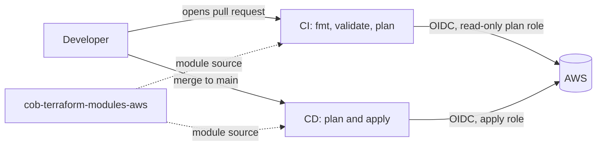

# cob-aws-infrastructure

Infrastructure for the COB platform on AWS, managed with Terraform and deployed by GitHub Actions.
Nothing here is applied by hand: every change goes through a pull request, a reviewed plan, and an automated apply.

## What this repo manages

| Stack | Folder | State key | Status |
|---|---|---|---|
| IAM groups and policies (dev) | `infra/iam` | `envs/dev/iam/terraform.tfstate` | Live |

Planned stacks: networking (VPC), compute (EC2, ECS, Lambda), storage (S3), database (RDS), data warehouse (Redshift), analytics (Glue, Athena).
Each gets its own folder under `infra/` and its own state key.

## How it works



- **CI** (`.github/workflows/ci.yml`) runs on every pull request. It checks formatting, validates the code, and runs a read-only `terraform plan`. The plan appears in the run summary.
- **CD** (`.github/workflows/cd.yml`) runs when code is merged to `main`. It plans again and applies exactly that plan.
- **No AWS keys are stored in GitHub.** Workflows exchange a short-lived GitHub OIDC token for AWS credentials.
  Pull requests can only assume the read-only plan role; only `main` can assume the apply role.
- **The pipeline cannot change its own access.** The OIDC provider, the two pipeline roles and the permissions boundary are created by a separate bootstrap stack,
  applied by an admin from a different repo. The apply role is explicitly denied changes to them.

## Repository layout

```
.github/workflows/
  ci.yml                       # pull requests: fmt, validate, plan
  cd.yml                       # push to main: plan, apply
infra/
  iam/
    iam.tf                     # backend, provider, module call, outputs
    variables.tf               # project, environment, region
    locals.tf                  # naming and ARN conventions, reusable conditions
    policies.tf                # managed policies
    groups.tf                  # groups and the policies attached to each
    outputs.tf
    terraform.tfvars.example   # copy to terraform.tfvars for local runs
    .terraform.lock.hcl        # pinned provider versions (commit this)
images/
```

## Related repositories

| Repo | Purpose |
|---|---|
| `cob-terraform-modules-aws` | Reusable Terraform modules (this repo uses `modules/iam`) |
| Bootstrap repo | OIDC provider, pipeline roles, permissions boundary. Applied manually by an admin |


## IAM groups

Everything is scoped by name (`cob-dev-*`) and tags (`Project=COB`, `Environment=dev`).
People operate and query; the pipeline builds. No group can create or delete infrastructure.
Every group also receives a baseline policy: self-service password and MFA only, and everything else denied until the user signs in with MFA.

| Group | Can do |
|---|---|
| `cob-dev-junior-developer` | View compute, network, database, logs and metrics; read application buckets |
| `cob-dev-senior-developer` | The above, plus deploy Lambda code, restart ECS services, push images, start/stop tagged EC2, Session Manager, write application buckets |
| `cob-dev-junior-data-engineer` | View the platform; read data buckets; read the Glue catalog, jobs and crawlers; run Athena queries |
| `cob-dev-senior-data-engineer` | The above, plus write data buckets, start Glue jobs and crawlers, maintain tables, run Redshift SQL |
| `cob-dev-junior-analyst` | Run Athena queries on curated data only |
| `cob-dev-senior-analyst` | The above, plus Redshift SQL and a sandbox for tables and saved queries |

### Naming conventions the policies assume

| Resource | Pattern |
|---|---|
| All resources | `cob-dev-*` |
| App buckets | `cob-dev-app-*` |
| Data buckets | `cob-dev-data-*` with `curated/` and `sandbox/` prefixes |
| Athena results | `s3://cob-dev-athena-results/analytics/` |
| Athena workgroup | `cob-dev-analytics` |
| Glue databases | `cob_dev_*`, plus `cob_dev_sandbox` |
| EC2 tags | `Project=COB`, `Environment=dev` |

If a module names something differently, change it in `infra/iam/locals.tf`.